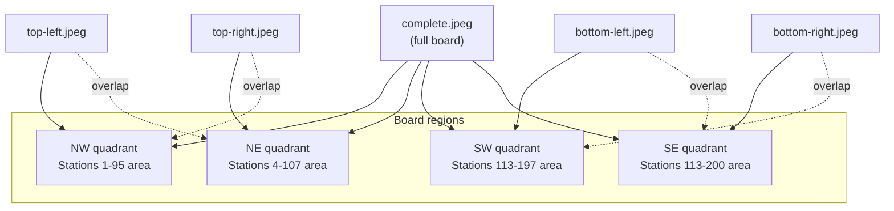
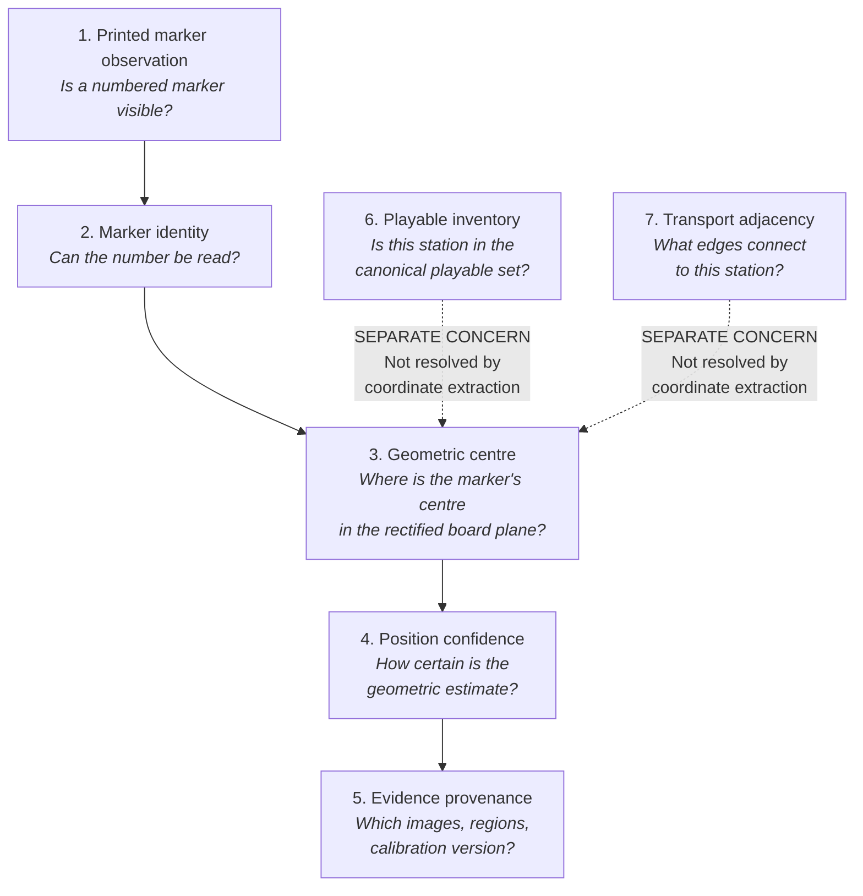
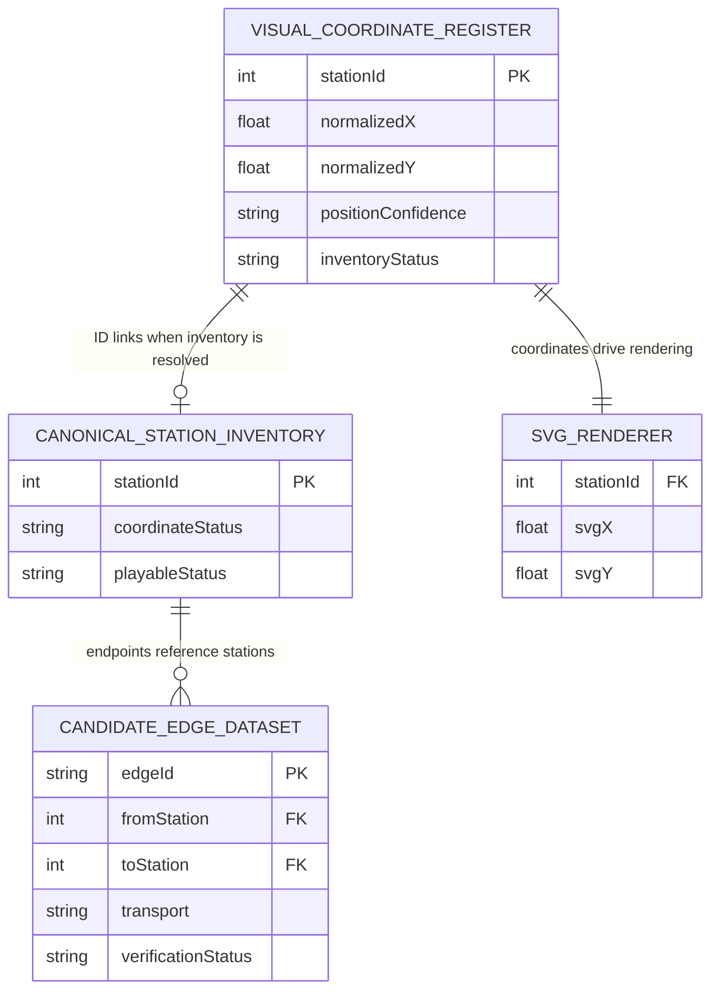

# Phase 3C.3 — Evidence and Calibration Proposal

> **Status:** Proposal — awaiting project-owner review and approval
> **Phase:** 3C.3-A — Evidence and calibration assessment
> **Date:** 5 November 2026
> **Author:** Computer-vision / board-reconstruction analysis (multimodal model)
> **Scope boundary:** This document is a proposal only. It does not create canonical coordinates, canonical transport edges, final SVG artwork, or any changes to application code or packages.

---

## 1. Executive summary

Phase 3C.3 requires reconstructing the physical Scotland Yard board's geometry from photographs into a stable coordinate system suitable for a bespoke SVG board. This proposal assesses the available evidence, recommends a calibration methodology, defines a coordinate system, proposes a station-extraction workflow, explains how geometry and transport graph must remain separate, recommends a layered SVG architecture, and catalogues every material uncertainty that blocks reliable reconstruction.

### Key findings

1. **The five primary photographs are sufficient for approximate coordinate reconstruction** — they provide full board coverage, overlap in every region, and readable station markers 1–200. They are **not** sufficient for sub-pixel precision or fully automated stitching.

2. **`complete.jpeg` is the strongest single reference** for global geometry because it captures the entire board with all four corners visible. However, at 1280×892 it limits station-centre precision to approximately ±3–5 px in image space (≈ 0.003–0.005 in normalized board coordinates).

3. **The four close-ups materially improve local precision** (approximately 2× the pixel density of the complete view in their covered regions) but each is rotated ~90° relative to the board and has perspective distortion. Their corners do not coincide with the board corners, requiring landmark-based registration rather than corner-based homography.

4. **A hybrid calibration approach is recommended:** corner-based planar homography on `complete.jpeg` to establish the master coordinate frame, then landmark-based registration for each close-up to refine station centres in overlapping regions.

5. **Station 200 is visible with high confidence.** Its geometric position can be recorded as an observed marker. Its playable-inventory status remains unresolved and is not addressed by this proposal.

6. **No canonical transport graph or playable station inventory is created by this proposal.** Visual coordinate data and transport graph data are deliberately maintained as separate concerns.

---

## 2. Evidence inventory and quality assessment

### 2.1 Primary board photographs

| ID     | File                | Dimensions | Orientation                         | Board coverage                                 | Station readability                                                            | Calibration utility                                                | Key limitations                                                                                                            |
| ------ | ------------------- | ---------: | ----------------------------------- | ---------------------------------------------- | ------------------------------------------------------------------------------ | ------------------------------------------------------------------ | -------------------------------------------------------------------------------------------------------------------------- |
| IMG-08 | `complete.jpeg`     |   1280×892 | Landscape, near-horizontal          | Full board; all 4 outer corners visible        | Medium — most station numbers readable at zoom; small numbers may be ambiguous | **Best global reference.** Four board corners → planar homography. | Low pixel density (~1.4 Mpx); mild perspective; board is on fabric with slight ripple; no calibrated capture               |
| IMG-09 | `top-left.jpeg`     |   925×1280 | Portrait, rotated ~90° CW vs. board | Northern/western region; stations 1–114 area   | High — station numbers are individually legible at close range                 | Good for local refinement; no board corners within frame           | Rotated; perspective distorted; cropped to region; 3 board edges partially visible (top, left, and parts of internal fold) |
| IMG-10 | `top-right.jpeg`    |   885×1280 | Portrait, rotated ~90° CW vs. board | Northern/eastern region; stations 4–107 area   | High — station numbers legible; Thames bridges visible                         | Good for local refinement and river-corridor detail                | Rotated; perspective distorted; board right edge and bottom-right corner partially visible                                 |
| IMG-11 | `bottom-left.jpeg`  |   914×1280 | Portrait, rotated ~90° CW vs. board | Southern/western region; stations 113–197 area | High — station numbers legible; Chelsea/Kensington area clear                  | Good for local refinement                                          | Rotated; perspective distorted; left edge visible; fold/seam visible                                                       |
| IMG-12 | `bottom-right.jpeg` |  1080×1499 | Portrait, rotated ~90° CW vs. board | Southern/eastern region; stations 113–200 area | High — station numbers legible; marker 200 clearly visible                     | Good for local refinement and station-200 confirmation             | Rotated; perspective distorted; "Scotland Yard" title visible at lower edge                                                |

### 2.2 Coverage overlap analysis



**Overlap regions confirmed by visual inspection:**

| Region pair            | Shared stations (approximate)             | Overlap utility                              |
| ---------------------- | ----------------------------------------- | -------------------------------------------- |
| IMG-09 ↔ IMG-10        | Stations near 13, 43–50, 57, 67 corridor  | ~30 shared stations; strong for registration |
| IMG-09 ↔ IMG-11        | Stations near 78–82, 95–100, 110 corridor | ~15 shared stations; moderate overlap        |
| IMG-10 ↔ IMG-12        | Stations near 105–108, 115–119 corridor   | ~12 shared stations; moderate overlap        |
| IMG-11 ↔ IMG-12        | Stations near 140, 155–157, 170 corridor  | ~15 shared stations; moderate overlap        |
| IMG-08 ↔ all close-ups | All stations                              | Global reference; lower precision            |

**Direct observation from photographs:**

- `complete.jpeg` is oriented with the board's top edge (River Thames, northern London) near the top of the image, slightly rotated. The board appears inverted/rotated ~180° compared to standard north-up orientation — the "RIVER THAMES" label appears at the **top** of the image, meaning south London (higher station numbers) is at the bottom. All four outer board corners and the central fold are visible.

- The four close-ups are each rotated approximately 90° clockwise relative to the board. This is consistent with the photographer turning the camera to capture detail in portrait mode while walking around the board.

- The board fold/seam is visible running vertically through the centre in `complete.jpeg` and is visible in overlapping close-ups. This fold introduces a potential local discontinuity of 1–3 mm in physical board space.

### 2.3 Supporting evidence (non-primary)

| Source                                                         | Role                                                                 | Authority level                                                       |
| -------------------------------------------------------------- | -------------------------------------------------------------------- | --------------------------------------------------------------------- |
| `full-1.jpeg`, `full-2.jpeg`, `full-3.jpeg` (older photoscans) | Secondary corroboration; may help resolve specific ambiguous markers | Supporting only — not committed to `docs/game/evidence/board-photos/` |
| `bottom right.jpeg` (older photoscan)                          | Additional lower-right detail                                        | Supporting only                                                       |
| `soctland-yard board pic.jpg` (older overview)                 | Earlier overall reference                                            | Supporting only; lower quality than primary set                       |
| `full-board-online-sample.png`                                 | Layout comparison only                                               | **Non-canonical** — online/recreated; not this edition                |
| `full-sample-2.webp`                                           | Layout comparison only                                               | **Non-canonical** — online/recreated; not this edition                |
| `starting cards.jpeg`                                          | Starting-card value evidence                                         | 13 of 18 values safely legible; not coordinate evidence               |
| `scotland-yard official rules.pdf`                             | Rules, edition identity, boat routes                                 | Primary for rules; does not prove board geometry                      |
| `Video-79477.mp4`                                              | Art-direction reference                                              | No board-coordinate evidence                                          |
| `youtube_video_transcipt.txt`                                  | Gameplay/rules aid                                                   | No coordinate evidence                                                |

### 2.4 Evidence sufficiency assessment

| Question                                                        | Assessment                                                                                                       | Confidence                                            |
| --------------------------------------------------------------- | ---------------------------------------------------------------------------------------------------------------- | ----------------------------------------------------- |
| Can the board boundary be identified?                           | Yes — all four corners visible in `complete.jpeg`                                                                | High                                                  |
| Can all 200 station markers be located?                         | Yes, at approximate precision from `complete.jpeg`; refined from close-ups where overlap exists                  | High for marker presence; Medium for centre precision |
| Is resolution sufficient for ±1 px station centres?             | No — `complete.jpeg` at 1280 px wide covers a board ~580 mm wide; ~2.2 px/mm is too coarse for sub-mm accuracy   | Low                                                   |
| Can transport routes be definitively traced?                    | Not from this task — route tracing requires separate endpoint-crop analysis and is explicitly out of scope       | N/A (separate concern)                                |
| Is an automated stitching pipeline feasible?                    | Not reliably — the close-ups are heavily rotated, perspective-distorted, and lack controlled calibration targets | Low                                                   |
| Is the evidence sufficient for a usable initial coordinate set? | **Yes** — with documented precision limits and confidence levels                                                 | Medium-High                                           |

> [!IMPORTANT]
> The five photographs are **sufficient for an initial approximate coordinate reconstruction** with documented uncertainty. They are **not sufficient for a final calibrated coordinate set** that could claim ±0.001 normalized precision. The proposal proceeds with this understanding and explicitly records the precision limits.

---

## 3. Image calibration methodology

### 3.1 Recommended approach: hybrid corner + landmark registration

The calibration strategy uses two complementary techniques:

#### Step 1: Master frame from `complete.jpeg` (corner-based homography)

1. Manually identify the four outer board corners in `complete.jpeg` pixel coordinates.
2. Compute a 3×3 planar homography matrix `H_complete` that maps these four image points to a fixed working rectangle (the board coordinate frame).
3. Apply `H_complete` to warp the complete image into the rectified board plane.
4. Validate the rectification by checking that the outer border lines are straight and perpendicular, and that the fold/seam is vertical.
5. Extract initial station-centre estimates from the rectified `complete.jpeg`.

**Why corners work for `complete.jpeg`:** The board is a rigid planar surface (except at the fold). All four corners are visible. A single homography will correct the dominant perspective distortion. The fold introduces a local error (~1–3 mm), but across a ~580×400 mm board this is ≤0.5% — acceptable for initial coordinates.

**Quantitative precision estimate:** With a 1280 px image and ±2 px manual corner selection error, the homography introduces approximately ±0.002–0.004 positional error in normalized [0,1] coordinates. Station-centre selection adds another ±2–3 px, yielding a total working precision of approximately ±0.004–0.006 in normalized coordinates.

#### Step 2: Local refinement from close-ups (landmark-based registration)

1. For each close-up (IMG-09 through IMG-12), identify 8–15 landmark stations visible in both the close-up and the rectified `complete.jpeg`.
2. These landmarks should be distributed across the close-up's field of view, not clustered in one area.
3. Compute a separate homography `H_closeup` for each close-up using these landmark correspondences.
4. Apply `H_closeup` to warp each close-up into the same rectified board plane.
5. Extract refined station-centre estimates from the warped close-ups.
6. Compare the close-up-derived coordinates against the `complete.jpeg`-derived coordinates in overlapping regions.
7. Record the registration residuals (the difference between where a station appears in the complete view vs. the close-up after registration).

**Why landmarks work for close-ups:** The close-ups do not contain four identifiable board corners. Instead, printed station markers serve as stable, identifiable landmarks. Using 8–15 well-distributed landmarks provides an over-determined system that can absorb some local lens distortion.

**Expected improvement:** The close-ups have approximately 2× the linear pixel density of `complete.jpeg` in their covered regions, so refined station centres should have approximately half the positional error — roughly ±0.002–0.003 in normalized coordinates.

#### Step 3: Overlap validation and residual analysis

1. For every station visible in two or more registered images, compare the independently derived normalized coordinates.
2. Compute the Euclidean residual in normalized coordinates for each such station.
3. Report the median and maximum residuals.
4. Flag any station where the residual exceeds a threshold (proposed: 0.005 in normalized coordinates, corresponding to ~3 px at the `complete.jpeg` resolution).
5. Large residuals may indicate: incorrect landmark pairing, local board deformation (fold/bow), or lens distortion not modelled by a single homography.

### 3.2 Rejected alternatives

| Approach                                                 | Reason for rejection                                                                                                                                                                                                                                       |
| -------------------------------------------------------- | ---------------------------------------------------------------------------------------------------------------------------------------------------------------------------------------------------------------------------------------------------------- |
| **Fully automatic feature matching (SIFT/ORB + RANSAC)** | The close-ups are rotated 90°, have significant perspective change, and the board surface has repetitive printed features (buildings, street lines) that would generate many false matches. Manual landmark selection is more reliable for 4–5 images.     |
| **Image stitching into a single mosaic**                 | Stitching would create a seamless composite image but would also introduce blending artifacts, seam errors, and hide registration residuals. It is better to keep images independent and compare coordinates.                                              |
| **Lens distortion correction**                           | No lens model or camera EXIF data is available. The board's printed border lines in `complete.jpeg` appear nearly straight, suggesting barrel/pincushion distortion is minor. Applying a guessed lens model risks introducing more error than it corrects. |
| **High-order polynomial warping**                        | Without a controlled calibration target (grid of known points), a polynomial warp beyond a simple homography is under-constrained and risks overfitting to landmark noise.                                                                                 |
| **Single close-up as master frame**                      | No single close-up covers the full board or has identifiable board corners.                                                                                                                                                                                |

### 3.3 Board fold treatment

**Observation:** The board fold is visible as a vertical line approximately 50% of the way across the board width. On a physical folding board, each half may sit at a slightly different angle when opened.

**Recommended treatment:**

1. Perform the initial homography using the four outer board corners of `complete.jpeg`. This treats the board as a single plane.
2. After extracting station centres, check whether stations near the fold show systematic displacement relative to stations far from the fold.
3. If systematic fold displacement is detected (expected magnitude: 0.001–0.003 in normalized coordinates), document it but do **not** apply a piecewise warp unless the error exceeds the working precision threshold.
4. If correction is needed in a future phase, model the fold as two half-plane homographies sharing the fold line.

### 3.4 Calibration data products

The calibration process should produce:

| Artifact                 | Contents                                                                                                                        |
| ------------------------ | ------------------------------------------------------------------------------------------------------------------------------- |
| Corner control points    | Four pixel coordinates per image (where visible) and their mapped board-plane positions                                         |
| Landmark correspondences | Per close-up: 8–15 station IDs with pixel coordinates in the close-up and expected normalized coordinates from the master frame |
| Homography matrices      | One 3×3 matrix per image (5 total)                                                                                              |
| Residual report          | Per-station overlap residuals for all multi-image stations                                                                      |
| Coverage quality map     | Per-station: which images contribute, at what pixel density, with what confidence                                               |

---

## 4. Proposed coordinate system

### 4.1 Board-local coordinate space

| Property             | Specification                                                                          | Rationale                                                                               |
| -------------------- | -------------------------------------------------------------------------------------- | --------------------------------------------------------------------------------------- |
| **Reference frame**  | The printed board's outer border rectangle                                             | Stable, printed, visible in evidence                                                    |
| **Origin**           | Top-left corner of the outer border                                                    | Consistent with SVG/screen convention                                                   |
| **x axis**           | Rightward along the top border                                                         | Standard screen orientation                                                             |
| **y axis**           | Downward along the left border                                                         | Standard SVG convention                                                                 |
| **Range**            | x ∈ [0, 1], y ∈ [0, 1]                                                                 | Normalized; resolution-independent                                                      |
| **Aspect ratio**     | Measured from `complete.jpeg` after rectification; approximately 1.43:1 (width:height) | Must be determined empirically, not assumed                                             |
| **Station position** | Centre of the printed numbered marker's surrounding circular/rounded outline           | Not the label text centroid; see §5                                                     |
| **Precision**        | Store 4 decimal places (0.0001 resolution)                                             | ~0.07 mm at physical board scale; well within working precision; round only for display |

### 4.2 SVG viewBox contract

```
viewBox="0 0 1000 <height>"
```

where `<height>` is computed from the measured board aspect ratio. If the board is 1.43:1, then height ≈ 699.

| Property                           | Specification                                                            |
| ---------------------------------- | ------------------------------------------------------------------------ |
| **viewBox width**                  | 1000 (fixed design-space units)                                          |
| **viewBox height**                 | Computed from measured aspect ratio (approximately 699)                  |
| **Mapping from normalized to SVG** | `svgX = normalizedX × 1000`, `svgY = normalizedY × height`               |
| **`preserveAspectRatio`**          | `xMidYMid meet`                                                          |
| **Responsive scaling**             | The SVG scales uniformly within its container; the viewBox never changes |

This contract is compatible with the existing `BoardSvg.tsx`, which already uses `viewBox="0 0 1000 680"`. The height may need minor adjustment (680 → ~699) when the actual aspect ratio is measured.

### 4.3 Coordinate provenance model

Every station coordinate should carry:

```typescript
type StationCoordinate = {
  stationId: number; // Printed marker number
  normalizedX: number; // [0, 1]
  normalizedY: number; // [0, 1]
  positionConfidence: 'high' | 'medium' | 'low';
  primarySourceImage: string; // e.g. "top-left.jpeg"
  crossCheckImages: string[]; // other images where verified
  maxOverlapResidual: number | null; // in normalized coords
  markerVisibility: 'clear' | 'readable' | 'ambiguous';
  inventoryStatus: 'observed-marker'; // never 'canonical-playable' at this stage
  notes: string;
};
```

> [!NOTE]
> This type is illustrative. The actual implementation should extend or align with the existing `BoardStation` type in `packages/board-data/src/types.ts` through a compatible visual-coordinate register, not by modifying the canonical type.

### 4.4 Stability across viewports

The normalized coordinate system is inherently viewport-independent:

- **Desktop:** The SVG container receives maximum available width; `preserveAspectRatio="xMidYMid meet"` ensures the board scales proportionally.
- **Mobile/tablet:** The same SVG is rendered at a smaller scale; normalized coordinates remain identical.
- **Pan/zoom:** Applied as a transform on the SVG group containing the board, exactly as the existing `BoardViewport.tsx` implements. Coordinates are never modified by viewport transforms.
- **Future coordinate corrections:** Updating a station's normalized coordinate changes only the data, not the SVG infrastructure.

---

## 5. Station extraction methodology

### 5.1 Conceptual separation

The extraction process distinguishes these independent concerns:



### 5.2 Station-centre definition

**The station centre is the visual centre of the printed marker's surrounding boundary shape**, which on this board is a small rounded rectangle with a yellow background containing a printed number.

Specifically:

- Locate the outer boundary of the yellow marker background.
- The centre is the geometric midpoint of this boundary.
- This is **not** the centroid of the printed digits (which may be asymmetrically placed within the marker).
- When a transport route line passes through or touches the marker, use the marker boundary, not the route intersection.

### 5.3 Extraction workflow

**Pass 1 — Master frame extraction (from `complete.jpeg`)**

1. Apply homography `H_complete` to produce the rectified board image.
2. Working in numeric order from 1 to 200, locate each visible marker.
3. For each marker, record: station ID, pixel coordinates in the rectified image, normalized coordinates, marker visibility (clear/readable/ambiguous), and any notes.
4. This produces ~200 initial coordinate estimates with ±0.004–0.006 precision.

**Pass 2 — Close-up refinement (from IMG-09 through IMG-12)**

5. For each close-up, apply its registration homography `H_closeup`.
6. For every station visible in the close-up, extract the refined centre from the higher-resolution warped image.
7. Compare against the Pass 1 estimate.
8. If the residual is within the threshold (0.005), adopt the close-up-derived coordinate as the refined estimate (higher pixel density → higher precision).
9. If the residual exceeds the threshold, flag the station for manual review and record both estimates.

**Pass 3 — Overlap cross-check**

10. For stations visible in two close-ups, compare the independently refined coordinates.
11. Record the cross-check residual.
12. Stations with agreeing close-up estimates (residual < 0.003) receive `positionConfidence: 'high'`.
13. Stations visible in only one close-up receive `positionConfidence: 'medium'`.
14. Stations visible only in `complete.jpeg` receive `positionConfidence: 'medium'` or `'low'` depending on marker clarity.

**Pass 4 — Manual review of flagged stations**

15. Inspect each flagged station's source crops.
16. Determine whether the discrepancy is caused by fold distortion, landmark misidentification, or genuine ambiguity.
17. Record the resolution and final coordinate, or leave as `positionConfidence: 'low'` if unresolved.

### 5.4 Station 200 handling

Station 200 is extracted using exactly the same procedure as stations 1–199:

- Its marker is visible with high clarity in `bottom-right.jpeg`.
- Its geometric centre can be estimated with medium-to-high confidence.
- Its `inventoryStatus` remains `'observed-marker'`.
- It is **not** added to any canonical playable station list.
- The provisional edge `E-086` (199–200, taxi) remains provisional and is not rendered as an authoritative connection.

### 5.5 Output format

The extraction produces a machine-readable register:

```jsonc
{
  "metadata": {
    "registerId": "phase-3c3-visual-coordinate-register",
    "version": "1.0.0",
    "calibrationVersion": "complete-homography-v1",
    "canonicalStatus": "non-canonical",
    "coordinateSystem": "normalized-0-to-1",
    "boardAspectRatio": null, // TBD from measurement
    "extractionDate": "2026-11-XX",
  },
  "markers": [
    {
      "stationId": 1,
      "normalizedX": 0.0, // placeholder
      "normalizedY": 0.0, // placeholder
      "positionConfidence": "high",
      "primarySourceImage": "top-left.jpeg",
      "crossCheckImages": ["complete.jpeg"],
      "maxOverlapResidual": 0.002,
      "markerVisibility": "clear",
      "inventoryStatus": "observed-marker",
      "notes": "",
    },
    // ... one entry per observed marker, 1 through 200
  ],
}
```

This register is explicitly **non-canonical**. It records visual observations with provenance, not playable game data.

---

## 6. Separation of geometry and transport graph

### 6.1 Design principle

Station coordinates and transport edges are independent evidence domains:

| Concern                    | Data source                                 | Current status                            | Owned by                               |
| -------------------------- | ------------------------------------------- | ----------------------------------------- | -------------------------------------- |
| Station visual position    | Board photographs + calibration             | To be extracted (this phase)              | Visual coordinate register             |
| Playable station inventory | Edition identity + owner decision           | Deferred (D-01, D-21)                     | `packages/board-data` canonical status |
| Transport edges            | Physical route tracing + independent review | 0 verified; 121 provisional; 4 unresolved | Candidate edge dataset                 |
| Movement legality          | Verified graph + game rules                 | Not implemented                           | Future game engine                     |

### 6.2 Linking mechanism

Station IDs (integers 1–200) serve as the common key between all data structures:



### 6.3 Non-coupling rules

1. The visual coordinate register may reference station IDs that are not (yet) in the canonical playable inventory.
2. The SVG renderer may display observed markers without implying they are playable stations.
3. The candidate edge dataset may reference station IDs that have visual coordinates without those edges becoming canonical.
4. The game engine (future) consumes only the canonical board-data package, never the visual coordinate register directly.
5. No coordinate extraction, however precise, promotes a candidate edge to verified status.

---

## 7. SVG layer architecture

### 7.1 Proposed layer stack

```mermaid
flowchart TB
    subgraph "SVG Scene (single coordinated group)"
        L1["Layer 1: Board base<br/><code>&lt;g class='board-base'&gt;</code><br/>Paper fill, outer border,<br/>aged texture, fold line"]
        L2["Layer 2: Geography<br/><code>&lt;g class='geography'&gt;</code><br/>Land masses, parks, green spaces,<br/>district shading, landmarks"]
        L3["Layer 3: Water<br/><code>&lt;g class='water'&gt;</code><br/>River Thames, docks,<br/>Serpentine, canals,<br/>bridge structures"]
        L4["Layer 4: Transport routes<br/><code>&lt;g class='transport-routes'&gt;</code><br/>Taxi (solid yellow),<br/>Bus (solid green),<br/>Underground (dashed red),<br/>Boat (blue, on water)"]
        L5["Layer 5: Station markers<br/><code>&lt;g class='station-markers'&gt;</code><br/>Yellow rounded-rect markers<br/>with station numbers"]
        L6["Layer 6: Station labels<br/><code>&lt;g class='station-labels'&gt;</code><br/>Landmark names, district labels,<br/>place names"]
        L7["Layer 7: Move hints<br/><code>&lt;g class='move-hints'&gt;</code><br/>Legal-destination highlights<br/>(runtime state only)"]
        L8["Layer 8: Pawns<br/><code>&lt;g class='pawns'&gt;</code><br/>Player/Mr X positions<br/>(runtime state only)"]
        L9["Layer 9: Interaction<br/><code>&lt;g class='interaction'&gt;</code><br/>Selection rings, hover effects,<br/>focus indicators, callouts"]
    end

    L1 --> L2 --> L3 --> L4 --> L5 --> L6 --> L7 --> L8 --> L9
```



### 7.2 Data vs. decoration separation

| Layer               | Data source                     | Evidence requirement                                                | Art-direction scope                                                                                     |
| ------------------- | ------------------------------- | ------------------------------------------------------------------- | ------------------------------------------------------------------------------------------------------- |
| 1. Board base       | None (pure presentation)        | None                                                                | Paper-100 fill, border, Metropolitan Casefile texture                                                   |
| 2. Geography        | Reference from photographs      | Approximate — preserves relative positions of parks, building areas | Simplified/stylized interpretation of printed board geography                                           |
| 3. Water            | Reference from photographs      | Approximate — Thames course, major bends, bridges                   | Styled with `--water-blue`                                                                              |
| 4. Transport routes | **Verified edges only**         | Each route must be individually verified before rendering           | Styled per transport type using approved colour tokens; **no provisional routes rendered as canonical** |
| 5. Station markers  | Visual coordinate register      | Per-marker position from calibrated extraction                      | Yellow markers matching the physical board treatment                                                    |
| 6. Station labels   | Reference from photographs      | Approximate placement                                               | Separate label-offset metadata; labels do not define station centres                                    |
| 7–9. Runtime        | Server-authoritative game state | N/A                                                                 | As specified in design-system brief                                                                     |

> [!CAUTION]
> Layer 4 (transport routes) must **never** consume the 125-row candidate edge dataset as if it were a verified graph. Routes should be added to this layer only as individual edges pass the verification gate defined in `BOARD-GRAPH-VERIFICATION.md`. Until that gate passes, the SVG may show approximate geography and station markers but no authoritative route lines.

### 7.3 Interim rendering strategy

While the transport graph remains unverified:

1. **Station markers** can be rendered from the visual coordinate register as soon as the owner approves the extracted coordinates.
2. **Geography, water, and board base** can be designed as stylized interpretations of the physical board, clearly labelled as decorative/approximate artwork.
3. **Transport routes** should be omitted or rendered with a clear "unverified/provisional" visual treatment (e.g., very low opacity, dashed with a different pattern) if the owner explicitly requests seeing provisional data.
4. The existing synthetic `demo-board-fixture.ts` remains the active frontend data source until canonical data is available.

### 7.4 Hit target and interaction design

| Element         | Visible size               | Hit target size                                       | Notes                                                  |
| --------------- | -------------------------- | ----------------------------------------------------- | ------------------------------------------------------ |
| Station marker  | ~8–12 SVG units (radius)   | 22 SVG units (radius), matching current `station-hit` | Invisible expanded hit circle for reliable click/touch |
| Station label   | Text at readable size      | Clicks on labels select the associated station        | Labels are positioned via separate offset metadata     |
| Transport route | 2–4 SVG units stroke width | Not directly interactive in current scope             | Routes do not define clickable areas                   |

### 7.5 Responsive and pan/zoom integration

The SVG architecture is compatible with the existing `BoardViewport.tsx`:

- The entire board scene is wrapped in a single `<g>` element that receives the viewport transform (`translate` + `scale`).
- The viewBox remains fixed; the transform handles pan/zoom.
- Labels at high zoom levels should remain readable; at minimum zoom the station markers should remain distinguishable.
- The board aspect ratio is preserved by `preserveAspectRatio="xMidYMid meet"`.

---

## 8. Uncertainty and risk register

### 8.1 Material uncertainties

| ID   | Uncertainty                                 | Why it matters                                                                                                                                                                | Current evidence                                                                                                                 | Resolution needed                                                                                      | Blocks next stage?                                                                                       |
| ---- | ------------------------------------------- | ----------------------------------------------------------------------------------------------------------------------------------------------------------------------------- | -------------------------------------------------------------------------------------------------------------------------------- | ------------------------------------------------------------------------------------------------------ | -------------------------------------------------------------------------------------------------------- |
| U-01 | **Board/rulebook edition match**            | If the photographed board is a different edition than the 4500-X2 rulebook, station count, numbering, and route topology may differ                                           | Board photos show consistent Milton Bradley visual family; rulebook page 12 identifies 4500-X2; no legible board copyright panel | High-resolution photograph of the board's copyright/product panel                                      | **No** for coordinate extraction (we extract what's visible); **Yes** for canonical inventory decision   |
| U-02 | **Station 200 playable status**             | Determines whether the canonical board has 199 or 200 playable stations                                                                                                       | Marker 200 is clearly visible; rulebook does not state station count; project plan assumes 199                                   | Edition identity resolution (U-01) + explicit owner decision                                           | **No** for coordinate extraction (position recorded as observed marker); **Yes** for canonical inventory |
| U-03 | **Complete.jpeg resolution limit**          | At 1280×892, station centres can be located to approximately ±0.004–0.006 in normalized coordinates — sufficient for initial reconstruction but not for final sub-mm fidelity | `complete.jpeg` dimensions: 1280×892                                                                                             | A higher-resolution straight-on board scan (≥4000 px on the long axis) would reduce error by ~3×       | **No** — current resolution is sufficient for a usable initial coordinate set                            |
| U-04 | **Board fold geometric discontinuity**      | The physical fold may cause ~1–3 mm displacement of stations near the fold line                                                                                               | Fold visible in `complete.jpeg` and multiple close-ups                                                                           | After extraction, measure fold-proximate station residuals; if significant, apply piecewise correction | **No** — expected magnitude is within working precision                                                  |
| U-05 | **Close-up rotation and perspective**       | Each close-up is rotated ~90° and perspective-distorted; landmark registration may introduce systematic error if landmarks are poorly distributed                             | All four close-ups exhibit this                                                                                                  | Careful landmark selection; residual analysis after registration                                       | **No** — this is a methodological concern addressed by the calibration procedure                         |
| U-06 | **Transport graph verification**            | 0 of 125 candidate edges are verified; the SVG cannot render authoritative routes                                                                                             | Phase 3C.2 audit result: Option B                                                                                                | Complete endpoint-crop analysis and independent review (future phases)                                 | **No** for coordinate extraction; **Yes** for route rendering                                            |
| U-07 | **Starting-card completeness**              | Only 13 of 18 card values are legible                                                                                                                                         | `starting cards.jpeg` (IMG-03)                                                                                                   | Controlled photograph of all 18 cards face-up                                                          | **No** for coordinate extraction                                                                         |
| U-08 | **Absent camera/lens metadata**             | No EXIF data available for lens model, focal length, or capture settings                                                                                                      | N/A                                                                                                                              | Capture new photos with EXIF preserved, or test straight-line fidelity empirically                     | **No** — lens distortion appears minor in `complete.jpeg` border lines                                   |
| U-09 | **Nine multi-transport endpoint conflicts** | Nine station pairs have both taxi and bus (or bus and underground) observations — may represent genuine multi-modal connections or transcription errors                       | Phase 3B.6 review; `BOARD-EDGE-HUMAN-REVIEW.md`                                                                                  | Annotated endpoint crops + independent review                                                          | **No** for coordinate extraction; **Yes** for graph verification                                         |
| U-10 | **Boat route physical verification**        | Four boat candidates (108–115, 115–118, 115–157, 157–194) are unresolved; rulebook supports three of these but photo-to-rulebook edition link is not proven                   | Rulebook p.10; Thames region in photographs                                                                                      | High-resolution Thames corridor crops + edition identity                                               | **No** for coordinate extraction; **Yes** for graph verification                                         |

### 8.2 Risk assessment

| Risk                                                                                                       | Likelihood    | Impact                                                                 | Mitigation                                                                       |
| ---------------------------------------------------------------------------------------------------------- | ------------- | ---------------------------------------------------------------------- | -------------------------------------------------------------------------------- |
| Homography from `complete.jpeg` introduces systematic positional error due to board not being truly planar | Medium        | Low-Medium (±0.003 systematic bias)                                    | Residual analysis against close-ups; document any systematic pattern             |
| Landmark misidentification in close-up registration causes localized coordinate errors                     | Low           | Medium (5–15 stations with ±0.01 error)                                | Use 8–15 well-distributed landmarks; verify each landmark ID against both images |
| Board fold is more severe than expected, creating a visible seam in the reconstructed coordinates          | Low           | Medium                                                                 | Piecewise correction available; may require new flat scan                        |
| Station centre definition is inconsistent between extractors                                               | Medium        | Low (±0.002 systematic offset)                                         | Define the centre rule precisely (§5.2); use the marker boundary, not the label  |
| Future higher-resolution scans require re-extraction, invalidating this phase's coordinates                | High (likely) | Low (re-extraction is straightforward with the documented methodology) | Store calibration procedure and provenance; make re-extraction reproducible      |

---

## 9. Recommended next steps

| Step   | Description                                                                                                                                        | Dependency                                  | Deliverable                                                                   |
| ------ | -------------------------------------------------------------------------------------------------------------------------------------------------- | ------------------------------------------- | ----------------------------------------------------------------------------- |
| **1**  | Owner reviews and approves this proposal                                                                                                           | None                                        | Approval decision                                                             |
| **2**  | Implement calibration tooling: a Python or TypeScript script that applies the homography to `complete.jpeg` and produces a rectified working image | Proposal approval                           | Rectified reference image; homography matrix; corner control points           |
| **3**  | Landmark selection for close-ups: manually identify 8–15 shared station landmarks per close-up                                                     | Step 2                                      | Landmark correspondence tables                                                |
| **4**  | Close-up registration: compute and apply `H_closeup` for each close-up                                                                             | Step 3                                      | Four registered close-up images; per-station residual report                  |
| **5**  | Station-centre extraction: extract normalized coordinates for all 200 observed markers using the workflow in §5.3                                  | Step 4                                      | Machine-readable visual coordinate register (`board-visual-coordinates.json`) |
| **6**  | Human review register: produce a reviewable document with per-station evidence and confidence                                                      | Step 5                                      | `BOARD-VISUAL-COORDINATE-REGISTER.md`                                         |
| **7**  | SVG board base and geography design: create layers 1–3 (board base, geography, water) from the approved art direction                              | Proposal approval; independent of Steps 2–6 | SVG board base asset                                                          |
| **8**  | SVG station markers: render station markers from the coordinate register                                                                           | Step 6                                      | SVG with data-driven station markers                                          |
| **9**  | Owner review of coordinate accuracy: visual overlay of extracted coordinates on the rectified board photo                                          | Step 8                                      | Overlay comparison image                                                      |
| **10** | Transport route rendering: add routes to layer 4 **only** as individual edges pass the verification gate                                           | Future graph verification phases            | Incremental route addition                                                    |

Steps 2–6 are sequential. Step 7 can proceed in parallel.

---

## 10. Acceptance criteria

This proposal is ready for owner approval when:

- [ ] All specified repository documents have been inspected and their findings are reflected here.
- [ ] All five primary photographs have been inspected at their available resolution.
- [ ] The evidence sufficiency assessment explicitly states what the photographs can and cannot support.
- [ ] The calibration methodology is technically sound and reproducible.
- [ ] The coordinate system is defined, justified, and compatible with the existing codebase.
- [ ] The station extraction methodology separates marker observation, identity, position, confidence, and inventory status.
- [ ] Station 200 is handled as an observed marker without resolving its playable status.
- [ ] The transport graph is explicitly excluded from the coordinate extraction task.
- [ ] The SVG architecture is layered and separates decorative artwork from authoritative data.
- [ ] Every material uncertainty is catalogued with its evidence source, impact, and resolution path.
- [ ] No canonical coordinates, transport edges, or playable inventory decisions have been created.

---

## Appendix A — Files inspected

### Repository documents

| File                                                                | Inspected                  |
| ------------------------------------------------------------------- | -------------------------- |
| `README.md`                                                         | ✓                          |
| `docs/game/PHASE-3C3-RECONSTRUCTION-BRIEF.md`                       | ✓                          |
| `docs/game/SCOTLAND-YARD-LIVE-PHASE-3C3-EVIDENCE-MANIFEST.md`       | ✓                          |
| `docs/game/BOARD-EVIDENCE-REGISTER.md`                              | ✓                          |
| `docs/game/BOARD-COORDINATE-RECONSTRUCTION.md`                      | ✓                          |
| `docs/game/BOARD-GRAPH-VERIFICATION.md`                             | ✓                          |
| `docs/game/BOARD-CANONICAL-GRAPH-DECISION.md`                       | ✓                          |
| `docs/game/BOARD-EDITION-IDENTITY.md`                               | ✓                          |
| `docs/game/BOARD-CANONICAL-INVENTORY-DECISION.md`                   | ✓                          |
| `docs/game/BOARD-STARTING-POSITIONS-AUDIT.md`                       | ✓                          |
| `docs/game/BOARD-DISCREPANCY-LEDGER.md`                             | ✓                          |
| `docs/game/BOARD-EDGE-TRANSCRIPTION.md`                             | ✓                          |
| `docs/game/BOARD-EDGE-HUMAN-REVIEW.md`                              | ✓                          |
| `docs/game/BOARD-STATION-INVENTORY.md`                              | ✓                          |
| `docs/game/BOARD-TRANSCRIPTION-WORKFLOW.md`                         | ✓                          |
| `docs/game/data/board-edge-candidates-1-200.json`                   | ✓ (structure and metadata) |
| `docs/game/data/board-edge-candidates.schema.json`                  | ✓                          |
| `docs/game/data/validate-board-edge-candidates.mjs`                 | ✓                          |
| `docs/frontend/SCOTLAND-YARD-LIVE-DESIGN-SYSTEM-BRIEF.md`           | ✓                          |
| `docs/frontend/SCOTLAND-YARD-LIVE-MOTION-COMPONENT-CATALOGUE.md`    | ✓                          |
| `docs/frontend/SCOTLAND-YARD-LIVE-VIDEO-ART-DIRECTION-REFERENCE.md` | ✓                          |
| `docs/frontend/VISUAL-IDENTITY-AND-EXPERIENCE.md`                   | ✓                          |
| `packages/board-data/src/types.ts`                                  | ✓                          |
| `packages/board-data/src/validate.ts`                               | ✓                          |
| `packages/board-data/src/canonical-status.ts`                       | ✓                          |
| `apps/web/src/features/board/types.ts`                              | ✓                          |
| `apps/web/src/features/board/components/BoardSvg.tsx`               | ✓                          |
| `apps/web/src/features/board/components/BoardViewport.tsx`          | ✓ (file listing confirmed) |

### Primary photographs

| File                                                | Inspected      | Dimensions confirmed |
| --------------------------------------------------- | -------------- | -------------------- |
| `docs/game/evidence/board-photos/complete.jpeg`     | ✓ (full image) | 1280×892             |
| `docs/game/evidence/board-photos/top-left.jpeg`     | ✓ (full image) | 925×1280             |
| `docs/game/evidence/board-photos/top-right.jpeg`    | ✓ (full image) | 885×1280             |
| `docs/game/evidence/board-photos/bottom-left.jpeg`  | ✓ (full image) | 914×1280             |
| `docs/game/evidence/board-photos/bottom-right.jpeg` | ✓ (full image) | 1080×1499            |

## Appendix B — Files created or modified

| File                                                       | Action                      |
| ---------------------------------------------------------- | --------------------------- |
| `docs/game/PHASE-3C3-EVIDENCE-AND-CALIBRATION-PROPOSAL.md` | **Created** (this document) |

No other files were created or modified. No application code, package dependencies, canonical data, or game rules were changed.

## Appendix C — Tests/checks performed

No automated tests were run as part of this proposal. The proposal does not introduce code changes. The existing candidate validator (`validate-board-edge-candidates.mjs`) and board-data tests (`packages/board-data/src/validate.test.ts`) remain unchanged.

## Appendix D — Unresolved questions requiring owner input

1. **Aspect ratio measurement:** Should I proceed with measuring the board aspect ratio from `complete.jpeg` during the coordinate extraction phase, or does the owner wish to supply a higher-resolution scan first?

2. **Higher-resolution scan:** The evidence register and reconstruction brief both recommend a straight-on, high-resolution (≥4000 px) board scan. The current photographs are sufficient for an initial coordinate set with ±0.004–0.006 precision. Does the owner wish to supply a better scan before coordinate extraction, or proceed with the available photographs and plan for a future refinement pass?

3. **Calibration tooling language:** Should the homography computation and image rectification be implemented in Python (using OpenCV, which has robust homography functions) or in TypeScript (which would keep the tooling within the monorepo but requires a manual matrix implementation or a suitable library)?

4. **SVG geography scope:** How detailed should the decorative geography layers (parks, landmarks, building areas) be in the initial SVG? Options range from minimal (paper base + station markers only) to moderate (major parks, Thames, and landmark buildings) to detailed (attempting to reproduce the full printed board's cartographic detail).

5. **Provisional route visualization:** Should provisional candidate edges ever be rendered in the SVG with a clearly distinct "unverified" visual treatment, or should routes appear only after individual verification?

---

> **This proposal is ready for project-owner review.** No coordinate extraction, SVG implementation, or canonical data changes will proceed until the owner has reviewed this document and provided approval or requested modifications.
